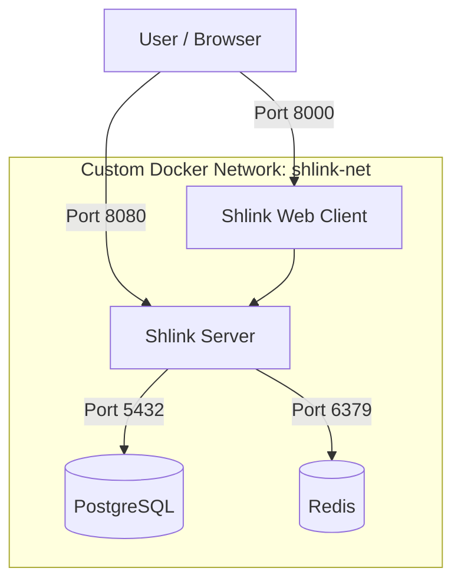

# Shlink Docker Architecture

## Network Details

- Network name: shlink-net
- Network driver: bridge
- Shlink Server: 8080
- Web Client: 8000
- PostgreSQL: 5432
- Redis: 6379

All services communicate using Docker's internal container networking.