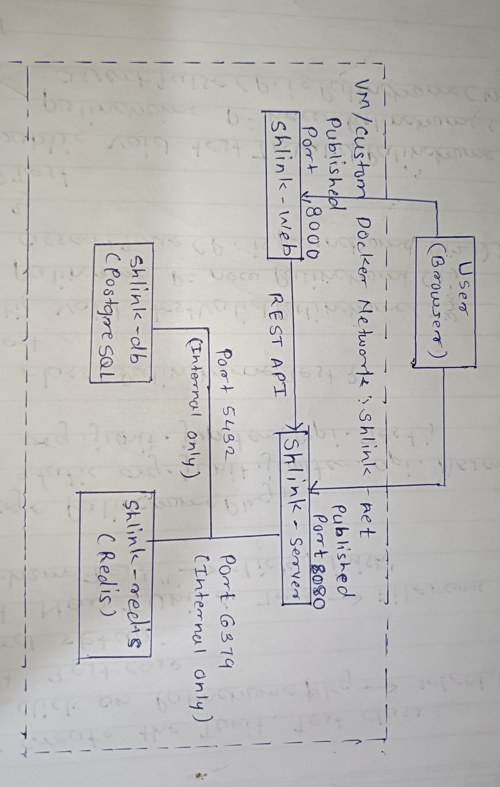

# DEVOPS-6 — Run Shlink with Plain Docker on a Custom Network

## Project Overview

This project deploys a multi-container Shlink URL-shortening stack using plain Docker Engine commands and a user-defined Docker bridge network (`shlink-net`), without Docker Compose.

## Technology Stack

- **Docker Engine** (Ubuntu / WSL2)
- **Shlink Server:** `shlinkio/shlink:5.1.6`
- **Shlink Web Client:** `shlinkio/shlink-web-client:4.8.1`
- **PostgreSQL:** `postgres:16-alpine`
- **Redis:** `redis:7-alpine`
- **BusyBox:** `busybox` (for DNS and connectivity verification)

## Architecture Diagram



*(Note: Ensure the rotated hand-drawn diagram file in the repository root matches `./diagram.jpg` or update the extension accordingly.)*

## Network & Port Configuration

All four containers run on the custom bridge network `shlink-net`. Only the Shlink Server and Web Client ports are published to the host; PostgreSQL and Redis remain strictly internal.

| Service | Container Name | Image (Pinned) | Published Host Port | Internal Port |
|---|---|---|---|---|
| Shlink Server | `shlink-server` | `shlinkio/shlink:5.1.6` | `8080` (`8080->8080/tcp`) | `8080` |
| Shlink Web Client | `shlink-web` | `shlinkio/shlink-web-client:4.8.1` | `8000` (`8000->8080/tcp`) | `8080` |
| PostgreSQL | `shlink-db` | `postgres:16-alpine` | None (internal only) | `5432` |
| Redis | `shlink-redis` | `redis:7-alpine` | None (internal only) | `6379` |

## Key Technical Findings

### 1. Default Bridge vs. User-Defined Network (`shlink-net`)
- **User-Defined Network (`shlink-net`):** Docker runs an embedded DNS server at `127.0.0.11` for user-defined bridge networks. Containers attached to `shlink-net` can dynamically resolve and reach each other by container name (e.g., `shlink-db` resolved to `172.18.0.2`), avoiding hardcoded IP addresses.
- **Default `bridge` Network:** Containers on the default bridge do not get automatic container-name DNS resolution; queries fall back to the host's upstream DNS resolver (`192.168.65.7`), causing `nslookup shlink-db` to fail with `NXDOMAIN`.

### 2. Database Failure & Recovery Behavior

When `shlink-db` was stopped, `GET /rest/health` immediately returned `HTTP/1.1 503 Service Unavailable` (`{"status":"fail",...}`):

```http
HTTP/1.1 503 Service Unavailable
Content-Length: 120
Content-Type: application/health+json
X-Request-Id: da8a7784-dd2e-46d3-82b3-3e760dd5d5a1
Date: Fri, 27 Nov 2026 12:19:49 GMT

{"status":"fail","version":"5.1.6","links":{"about":"https://shlink.io","project":"https://github.com/shlinkio/shlink"}}
```

**Server Log Output (`docker logs --tail 15 shlink-server` while `shlink-db` was stopped):**

```text
Initializing database if needed... Success!
Updating database... Success!
Generating proxies... Success!
Clearing entities cache... Success!
Creating first API key... Success!

1795781858418775096     debug   rpc     plugin was started      {"address": "tcp://127.0.0.1:6001", "list of the plugins with RPC methods:": ["lock", "resetter", "jobs", "informer", "app"]}
2026-11-27T12:17:38+0000        DEBUG   jobs            initializing driver     {"pipeline": "shlink", "driver": "memory"}
2026-11-27T12:17:38+0000        DEBUG   jobs            driver ready    {"pipeline": "shlink", "driver": "memory", "start": "2026-11-27T12:17:38+0000", "elapsed": 0}
1795781858419265878     debug   memory  pipeline was started    {"driver": "memory", "pipeline": "shlink", "start": "2026-11-27 12:17:38.419263619 +0000 UTC", "elapsed": "17.187µs"}
[INFO] RoadRunner server started; version: 2025.1.15, buildtime: 2026-06-17T16:05:22+0000
```

**What This Shows:**
- **Graceful Degradation (No Container Crash):** The RoadRunner application server inside `shlink-server` remained up and running without crashing or restarting when `shlink-db` stopped, and no unhandled fatal startup errors occurred.
- **Per-Request Health Probing:** Shlink evaluates database reachability dynamically per request rather than holding a single fragile startup lock. When `/rest/health` attempted to query `shlink-db:5432` and failed to connect, it caught the failure and returned `503 Service Unavailable` (`"status":"fail"`) so load balancers know not to route traffic to it.
- **Automatic Recovery:** Once `shlink-db` restarted, subsequent requests re-established PostgreSQL connections automatically without requiring a `shlink-server` restart, returning `/rest/health` to `200 OK` (`"status":"pass"`).

## Final Environment Cleanup Verification

All task containers and the `shlink-net` custom network were removed after verification:

```text
user1@LAPTOP-EMCVDVR6:~$ docker rm -f shlink-server shlink-redis shlink-db
shlink-server
shlink-redis
shlink-db

user1@LAPTOP-EMCVDVR6:~$ docker network rm shlink-net
shlink-net

user1@LAPTOP-EMCVDVR6:~$ docker ps -a
CONTAINER ID   IMAGE     COMMAND   CREATED   STATUS    PORTS     NAMES

user1@LAPTOP-EMCVDVR6:~$ docker network ls
NETWORK ID     NAME                                              DRIVER    SCOPE
911c8298d375   bridge                                            bridge    local
ed791f9acd0f   glynac-devops-infrastructure-security_redis-net   bridge    local
3de7878b6fbe   host                                              host      local
0d88ac19c659   none                                              null      local
```

## Security & Secrets Hygiene

- Only dummy development credentials (`dev-only-password` and `intern-dev-api-key-0001`) were used during deployment and testing.
- `SHLINK_SERVER_API_KEY` was intentionally omitted from `shlink-web` so credentials are not written into static browser-downloadable assets; the server connection was configured via the UI instead.

## Deliverables in This Repository

- `README.md` — Project overview, embedded architecture diagram, technical findings, and cleanup verification.
- `run-commands.md` — Complete end-to-end Docker setup, smoke test, failure test, and cleanup commands.
- `testing.md` — Verification logs and outputs for network isolation, DNS resolution, smoke tests (S1–S4), and database outage recovery.
- `diagram.jpg` & `Architecture.md` — Hand-drawn and Mermaid service topology diagrams.